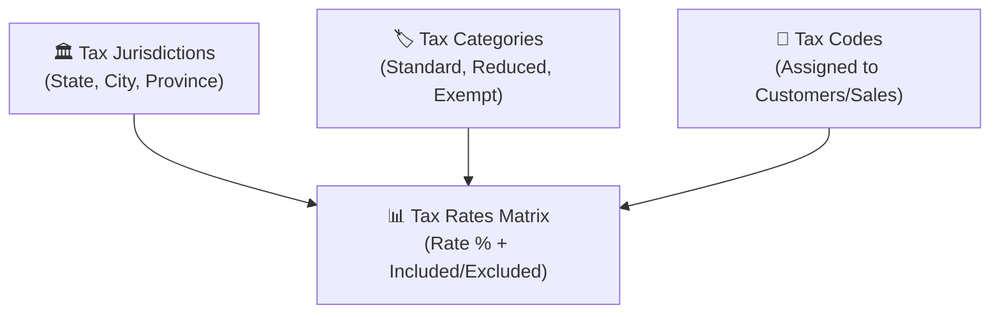

Open Source Point of Sale provides a multi-jurisdiction tax calculation engine supporting global taxation standards:
- **Sales Tax (Excluded)**: Tax is calculated on top of the net retail price at checkout (US, Canada).
- **Value Added Tax / VAT (Included)**: The retail price on the shelf already includes the tax amount (Europe, UK, Australia, South Africa).
- **Multi-Jurisdiction Tax Matrices**: Combinations of federal, state, county, and municipal tax rates.
- **India GST**: Automated split of Central GST (CGST), State GST (SGST), Integrated GST (IGST), and HSN/SAC codes.

---

## 1. The 4 Components of the OSPOS Tax Engine

Navigate to **Store Config** $\rightarrow$ **Taxes**:

1. **Tax Jurisdictions**: The taxing authority (e.g. *State of California*, *City of Denver*, or *National VAT*).
2. **Tax Categories**: Product groupings taxed at different percentages (e.g. *Standard Goods 20%*, *Groceries 5%*, *Medical Exempt 0%*).
3. **Tax Codes**: Assigned to sales and customers to govern geographic taxation.
4. **Tax Rates Matrix**: The intersection of a Jurisdiction + Category determining the exact percentage rate and whether tax is **Included** or **Excluded**.

---

## 2. Tax Calculation Types

In `Tax_lib.php`, OSPOS calculates taxes using two core modes:

### Tax Excluded (Type `1` - Standard Sales Tax)
The tax is added on top of the item price:
$$\text{Line Total} = \text{Unit Price} + (\text{Unit Price} \times \text{Tax Rate})$$

### Tax Included (Type `0` - European / UK VAT)
The tax is backed out of the retail price:
$$\text{Tax Amount} = \text{Gross Price} - \left( \frac{\text{Gross Price}}{1 + \text{Tax Rate}} \right)$$

---

## 3. Mathematical Rounding Modes

Different countries enforce different legal rounding rules for sales tax and retail cash transactions. In **Store Config** $\rightarrow$ **Taxes**, OSPOS provides 7 rounding modes from `Rounding_mode.php`:

| Rounding Option | Algorithmic Behavior | Common Regional Use |
| :--- | :--- | :--- |
| **Half Up** (`HALF_UP`) | Rounds halves up ($0.005 \rightarrow 0.01$). Standard commercial rounding. | United States, Global default |
| **Half Down** (`HALF_DOWN`) | Rounds halves down ($0.005 \rightarrow 0.00$). | Specific corporate policies |
| **Half Even** (`HALF_EVEN`) | Banker's rounding: rounds halves to the nearest even number. | Financial audits, ISO standards |
| **Round Up** (`ROUND_UP`) | Always rounds up towards positive infinity (Ceiling). | Specific municipal surcharges |
| **Round Down** (`ROUND_DOWN`) | Always rounds down towards zero (Floor). | Specific statutory deductions |
| **Half Five** (`HALF_FIVE`) | Rounds amounts to the **nearest 0.05 (5 cents)**. | **Canada, Switzerland, Australia, Eurozone** (eliminating 1-cent pennies from cash transactions) |

---

## 4. India GST (Goods and Services Tax) Compliance

OSPOS includes built-in compliance for India's GST tax regime.

### Intra-State vs. Inter-State Rules
- **Intra-State (Store & Customer in Same State)**:
  - OSPOS automatically divides the tax slab equally between **CGST** (Central GST) and **SGST** (State GST).
  - *Example (18% Slab)*: 9% CGST + 9% SGST.
- **Inter-State (Customer in Different State)**:
  - OSPOS levies the full rate as **IGST** (Integrated GST).
  - *Example (18% Slab)*: 18% IGST.

### Configuration Checklist:
1. Set store country to India (`IN`).
2. Enter your store's 15-digit **GSTIN** and 2-digit State Code.
3. In **Items**, enter the **HSN Code** (for goods) or **SAC Code** (for services) and the GST slab percentage.
4. For B2B customers, enter the customer's GSTIN and state code in their profile.
5. In **Reports** $\rightarrow$ **Taxes**, generate itemized HSN-wise summaries for monthly **GSTR-1** tax filing.
