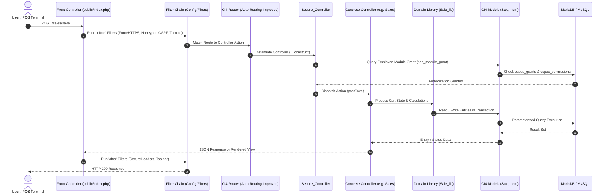

Open Source Point of Sale is built on **CodeIgniter 4**, a lightweight, high-performance PHP framework. It follows the standard **Model-View-Controller (MVC)** architectural pattern.

---

## 1. Directory Structure

```text
opensourcepos/
├── app/                      # Main application codebase
│   ├── Config/               # Framework and application configuration
│   ├── Controllers/          # HTTP request handlers and controller endpoints
│   ├── Database/
│   │   ├── Migrations/       # Database schema migrations
│   │   └── Seeds/            # Seed data for testing and initial install
│   ├── Entities/             # Business object entities
│   ├── Helpers/              # Global procedural helper functions
│   ├── Language/             # Multilingual translation arrays by locale
│   ├── Libraries/            # Reusable business logic (e.g., Sale_lib, Barcode_lib)
│   ├── Models/               # Database access layers (Active Record / Query Builder)
│   └── Views/                # User interface templates (PHP/HTML)
├── branding/                 # Official SVG logos, marks, and style guide
├── docs/                     # Core repository markdown documentation
├── public/                   # Web server document root
│   ├── dist/                 # Compiled JavaScript and CSS bundles
│   ├── uploads/              # Uploaded product images and store logos
│   └── index.php             # Front controller entrypoint
├── resources/                # Source SCSS, JavaScript, and uncompiled assets
├── tests/                    # PHPUnit automated test suites
├── writable/                 # Runtime logs, cache, and session storage
└── .env                      # Local environment secrets and configuration
```

---

## 2. Request Lifecycle & Filter Pipeline

Every incoming web request travels through CodeIgniter 4's filter pipeline, Auto-Routing Improved router, authentication gateways, and domain services:



---

## 3. Core Architectural Subsystems

### 3.1 Controllers & Auto-Routing Improved
OSPOS operates with CodeIgniter 4's **Auto-Routing (Improved)** (`Config\Feature::$autoRoutesImproved = true;`):
- All authenticated controllers inherit from `Secure_Controller`, which validates session state and role permissions in `__construct`.
- Controller action methods **must** be prefixed with their matching HTTP verb:
  - `getIndex()`: Renders the default module landing view.
  - `getSearch()`: Serves paginated, filtered JSON data to Bootstrap Table.
  - `getRow(int $id)`: Returns single updated row markup for in-place table updates.
  - `getSuggest()`: Supplies JSON autocomplete suggestions for search inputs.
  - `postSave(?int $id = -1)`: Handles form submissions and entity persistence.
  - `postDelete()`: Handles soft-deletion of selected entities.

### 3.2 Domain Service Libraries (`app/Libraries/`)
Complex business logic is encapsulated in reusable domain libraries to keep controllers lean:
- **Session-Backed State Managers**:
  - `Sale_lib`: Manages shopping cart state, active customer, dining table associations, item lines, discounts, and payment tenders stored in session.
  - `Receiving_lib`: Manages procurement receiving carts, vendor details, and stock location allocations.
- **Calculation Engines**:
  - `Tax_lib`: Multi-tier tax engine resolving destination/origin rules, compound tiers, VAT inclusion/exclusion, and India GST splits.
  - `Token_lib`: Token parser resolving date formatters (`%Y`, `%m`, `%d`) and sequence patterns (`{ISEQ}`, `{QSEQ}`, `{WSEQ}`, `{CO}`).
  - `Barcode_lib`: Barcode generation (EAN, UPC, Code 128) and font metric calculations.

### 3.3 Dynamic Table Management (AJAX Subsystem)
All administrative grids (Items, Customers, Suppliers, Expenses, Sales Takings) are driven by a unified AJAX table architecture:
- **Frontend**: `public/js/manage_tables.js` configures Bootstrap Table to handle client-side events, multi-row selections, batch deletion modals, and sorting.
- **Backend Endpoints**: The controller responds with JSON formatted as:
  ```json
  { "total": 142, "rows": [ { "item_id": 1, "name": "Item A", ... } ] }
  ```
- **Row Builders (`app/Helpers/tabular_helper.php`)**: Formats individual HTML table rows (`get_customer_data_row`, `get_item_data_row`), ensuring consistent badge styles, buttons, and action links.

### 3.4 Party Class-Table Inheritance
OSPOS avoids duplicating personal data (names, phone numbers, email addresses, street addresses) using the **Class-Table Inheritance** pattern:
- **Base Table**: `ospos_people` holds universal identity attributes (`person_id`, name, contact, gender).
- **Specialized Tables**: Linked 1:1 via foreign key `person_id`:
  - `ospos_employees`: Username, password hash, language preferences, grants.
  - `ospos_customers`: Account number, tax exemption, reward packages, discount tier.
  - `ospos_suppliers`: Company name, agency representative, vendor tax ID.

### 3.5 Office Navigation Grouping
Modules can belong to `home`, `office`, or `both` via `ospos_modules.menu_group`:
- When **Show Office Group** (`show_office_group`) is enabled in Store Config, frontline POS counter modules (Sales, Receivings) remain on the home screen, while back-office administrative modules (Config, Reports, Employees, Expenses) are neatly grouped under the **Office** portal (`/office`).

### 3.6 CodeIgniter 4 Services (`Config\Services`)
OSPOS accesses framework-level system singletons through the service container:
```php
$session    = \Config\Services::session();
$validation = \Config\Services::validation();
$language   = \Config\Services::language();
$security   = \Config\Services::security();
```


