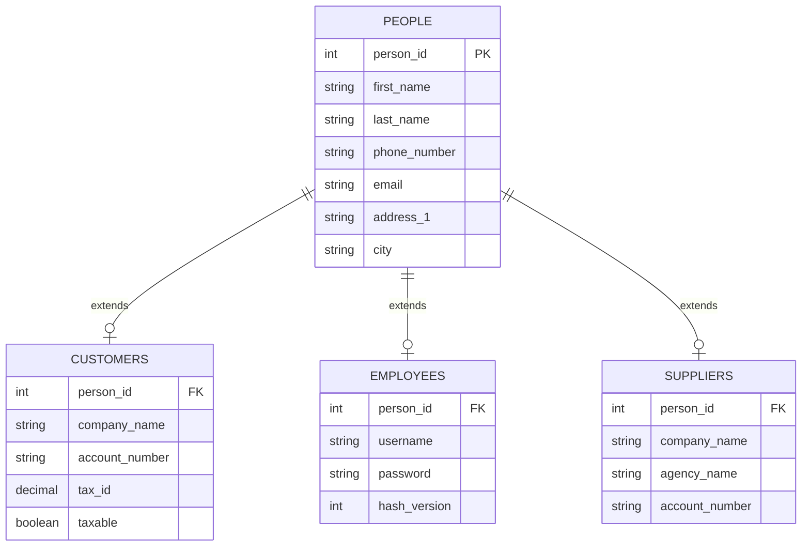

Open Source Point of Sale uses a relational database schema designed for MariaDB and MySQL. All table names use the configurable prefix `ospos_`.

---

## 1. Key Database Tables

### Polymorphic Person Design
To avoid duplicating contact fields (name, email, phone, address), OSPOS uses a central `ospos_people` base table linked via foreign keys to specific actor tables:



### Transaction Tables
- **`ospos_sales`**: Stores transaction headers (sale timestamp, customer ID, employee ID, sale status, work order notes).
- **`ospos_sales_items`**: Line items for each sale (item ID, quantity, unit price, cost price, discount percentage).
- **`ospos_sales_payments`**: Records every payment tendered for a transaction (payment type, amount, payment reference).
- **`ospos_sales_taxes`**: Itemized tax breakdowns recorded at the moment of sale for statutory reporting.

### Inventory Ledger & Audit Architecture
OSPOS separates current on-hand quantities from the historical movement log:
- **`ospos_item_quantities`**: Point-in-time on-hand stock quantities broken down by `item_id` and `location_id`.
- **`ospos_inventory` (Immutable Ledger)**: Every single inventory change (sale, customer return, supplier receiving, requisition transfer, physical count adjustment) writes an immutable transaction log record containing `trans_items`, `trans_user`, `trans_date`, `trans_inventory` (delta +/-), `trans_location`, and `trans_comment`. Stock balances can always be mathematically audited and reconciled.
- **`ospos_item_kits` & `ospos_item_kit_items`**: Bundle definitions and component quantities.

### Soft Deletion Pattern
Core entity tables (`ospos_items`, `ospos_customers`, `ospos_employees`, `ospos_suppliers`, `ospos_stock_locations`) do not physically delete database rows when a user clicks Delete. Instead, they set `deleted = 1`. This preserves relational integrity across historical sales, receipts, and tax records.

---

## 2. Working with Migrations

OSPOS uses CodeIgniter 4's built-in **Database Migration** system (`app/Database/Migrations/`) to track schema changes across releases.

### Creating a New Migration

Generate a new timestamped migration class:

```bash
php spark make:migration AddWarrantyToItems
```

This creates a file in `app/Database/Migrations/YYYY-MM-DD-HHMMSS_AddWarrantyToItems.php`.

### Writing the Migration (`up` and `down`)

```php
<?php

namespace App\Database\Migrations;

use CodeIgniter\Database\Migration;

class AddWarrantyToItems extends Migration
{
    public function up()
    {
        $fields = [
            'warranty_months' => [
                'type'       => 'INT',
                'constraint' => 5,
                'default'    => 0,
                'after'      => 'reorder_level',
            ],
        ];
        $this->forge->addColumn('items', $fields);
    }

    public function down()
    {
        $this->forge->dropColumn('items', 'warranty_months');
    }
}
```

### Running and Rolling Back Migrations

```bash
# Execute all pending migrations
php spark migrate

# Roll back the most recent batch of migrations
php spark migrate:rollback

# View current migration status
php spark migrate:status
```

:::tip[Automatic Production Migrations via MY_Migration]
In production environments, OSPOS uses a custom migration runner (`app/Libraries/MY_Migration.php`) that extends CodeIgniter's `MigrationRunner`. 

It intercepts schema upgrades by executing versioned delta scripts (`app/Database/Migrations/sqlscripts/`) and CodeIgniter migration classes automatically upon administrator login. This ensures seamless version upgrades without requiring manual SSH terminal access.
:::

