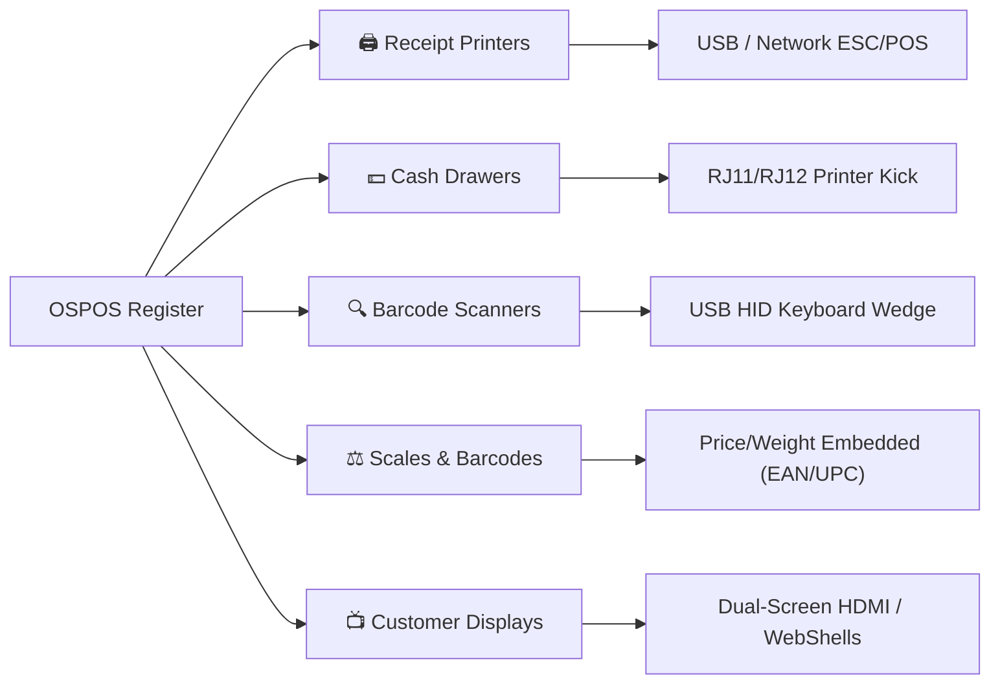

Open Source Point of Sale is hardware-agnostic. Because it is a web-based system operating on open standards (ESC/POS, USB HID, TCP/IP, and WebSerial), it works with standard point-of-sale peripherals from all major manufacturers.

---

## Supported Peripheral Classes

---

## Hardware Compatibility Matrix

| Peripheral Category | Connection Interface | Industry Standard Protocol | Tested & Recommended Brands |
| :--- | :--- | :--- | :--- |
| **Thermal Receipt Printers** | USB, Network Ethernet (TCP/IP), Wi-Fi, Serial RS-232 | **ESC/POS**, Star Line Mode | Epson (TM-T20, TM-T88), Star Micronics (TSP100, TSP650), Bixolon, Munbyn, Xprinter |
| **Cash Drawers** | RJ11 / RJ12 6-pin cable | Connected to Receipt Printer Drawer Kick Port | APG, MMF, Posiflex, Star, generic RJ11 drawers |
| **Barcode Scanners** | USB, Bluetooth, 2.4GHz Wireless Dongle | **USB HID Keyboard Wedge** | Zebra / Motorola (DS2208, LS2208), Honeywell (Voyager, Xenon), Datalogic, Inateck |
| **Weighing Scales** | Embedded Price/Weight Barcode label or Serial RS-232 | EAN-13 / UPC-A embedded barcodes, WebSerial | Avery Berkel, Mettler Toledo, Torrey, CAS, Brecknell |
| **Customer Displays** | HDMI Second Monitor, USB VFD Pole Display | ESC/POS VFD, HTML5 Second Screen | Dual-monitor HDMI, Logic Controls, Posiflex, Partner Tech |

---

## Recommended POS Workstation Setups

### 1. Traditional Countertop PC / Laptop Setup
- **Workstation**: Standard desktop PC, mini PC (Intel NUC / Beelink), or laptop running Windows, Ubuntu Linux, or macOS.
- **Display**: 15" to 22" touch or non-touch monitor.
- **Peripherals**: USB barcode scanner, USB thermal receipt printer, RJ11 cash drawer plugged into the printer.
- **Pros**: Inexpensive, uses existing hardware, easily repaired.

### 2. Compact All-in-One Touch POS Terminal
- **Workstation**: Commercial touch POS terminal (Elo Touch, Posiflex, HP Engage, Partner Tech).
- **Peripherals**: Integrated MSR, built-in thermal printer, customer-facing pole display.
- **Pros**: Clean commercial countertop appearance, spill-resistant, integrated cable management.

### 3. Ultra-Low Power / Raspberry Pi Setup
- **Workstation**: Raspberry Pi 4 or 5 running Raspberry Pi OS (Debian) in Kiosk mode.
- **Display**: Official Raspberry Pi 7" touchscreen or HDMI monitor.
- **Peripherals**: USB thermal printer, wireless barcode scanner.
- **Pros**: Compact, zero fan noise, consumes under 15 watts, ideal for mobile food trucks, outdoor pop-ups, and small boutiques.

