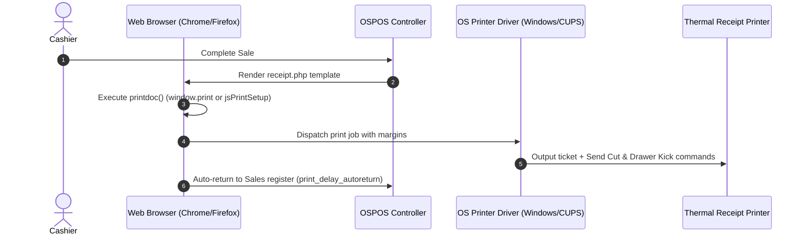

Open Source Point of Sale uses an **HTML/CSS Browser-Based Printing Architecture** to generate receipts, invoice slips, and estimates. 

Instead of relying on proprietary raw printer drivers or external print daemons, OSPOS renders standard web-compliant receipt templates (`app/Views/sales/receipt_default.php`) directly through your web browser's print engine. This ensures maximum compatibility with all thermal printer brands (Epson, Star Micronics, Bixolon, Munbyn, Xprinter) across Windows, Linux, macOS, and Android.

---

## 1. Paper Widths & Formats

- **80mm (3 1/8") Standard Width**: The universal retail standard (Epson TM-T88/TM-T20, Star TSP100, Bixolon SRP-350). Accommodates ~44 to 48 monospace characters per line.
- **58mm (2 1/4") Compact Width**: Used in compact countertop and mobile printers. Accommodates ~30 to 32 characters per line.

---

## 2. Printing Mechanics in OSPOS

When a cashier completes a transaction or clicks **Print** (`printdoc()`):



---

## 3. Recommended Setup: Silent Kiosk Printing (Zero Click)

In a high-throughput retail store, cashiers shouldn't have to click "Print" on a browser dialog for every sale. You can configure Google Chrome or Microsoft Edge for **Silent Kiosk Printing**.

### Windows Chrome / Edge Setup
1. Set your thermal receipt printer as the **Default Printer** in Windows (*Settings* $\rightarrow$ *Printers & Scanners*).
2. Right-click your Chrome or Edge desktop shortcut and select **Properties**.
3. In the **Target** field, append `--kiosk-printing` to the end of the line:
   ```text
   "C:\Program Files\Google\Chrome\Application\chrome.exe" --kiosk-printing
   ```
4. Click **Apply** and **OK**.
5. When launched from this shortcut, Chrome automatically prints receipts directly to your default thermal printer without showing the print dialog!

### Linux / Raspberry Pi Setup
When launching Chromium on Linux or Raspberry Pi, add the `--kiosk-printing` flag:
```bash
chromium-browser --kiosk-printing --kiosk http://localhost
```

---

## 4. Firefox `jsPrintSetup` Integration

For Mozilla Firefox users, OSPOS natively detects and interfaces with the `jsPrintSetup` extension:
- If installed, OSPOS automatically selects the configured receipt printer from local storage (`localStorage['receipt_printer']`).
- Sets page margins (`print_top_margin`, `print_left_margin`, `print_right_margin`, `print_bottom_margin`) dynamically in millimeters.
- Clears browser headers/footers (removes URLs and page numbers).
- Suppresses print dialogs programmatically via `jsPrintSetup.setOption('printSilent', 1)`.

---

## 5. Store Configuration Settings

Navigate to **Store Config** $\rightarrow$ **Receipt** to fine-tune your printing behavior:

| Setting | Purpose |
| :--- | :--- |
| **Print Silently** | Directs `jsPrintSetup` in Firefox to suppress print confirmation popups. |
| **Print Header / Footer** | Toggles whether browser headers (date, page title) and footers (URL) appear. |
| **Margins (Top, Left, Right, Bottom)** | Configures ticket margins in millimeters. |
| **Print After Sale** | Checkbox on the Sales register: when checked, automatically initiates printing immediately upon sale completion. |
| **Auto-Return Delay (`print_delay_autoreturn`)** | Number of seconds OSPOS waits on the receipt screen before automatically redirecting back to a clean Sales register for the next customer (e.g. `2` seconds). |

---

## 6. Paper Cut & Cash Drawer Triggering

Because OSPOS prints through the operating system print subsystem, paper cutting and cash drawer firing are controlled through your **Printer Driver Preferences**:

1. In Windows, open **Settings** $\rightarrow$ **Printers & Scanners** $\rightarrow$ Select your receipt printer $\rightarrow$ **Printer Properties**.
2. Open the **Device Settings** or **Document Properties** tab.
3. Configure:
   - **Paper Cut**: Set to *Partial Cut* or *Full Cut at End of Job*.
   - **Cash Drawer**: Set to *Open Drawer 1 Before Printing* or *Open Drawer 1 After Printing*.
4. Click **Apply**. Now, every time OSPOS prints a receipt, the printer driver automatically pops the cash drawer and cuts the receipt paper!
